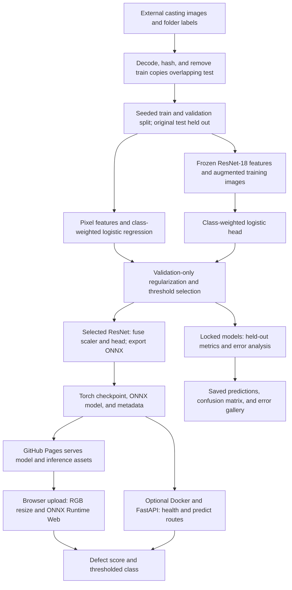

# Casting Defect Classification

Binary image classification for front-view industrial castings, with a pixel-based baseline, a frozen ResNet-18 feature extractor and trained logistic head, held-out evaluation, and public inference.

- [Live image-upload demo](https://abdullah-sarwar-mirza.github.io/casting-defect-ml-assessment/)
- [Technical report (PDF)](reports/technical_report.pdf) | [Markdown](reports/technical_report.md)

## Dataset and preparation

Source: Ravirajsinh Dabhi, [casting product image data for quality inspection](https://www.kaggle.com/datasets/ravirajsinh45/real-life-industrial-dataset-of-casting-product). Folder labels are `ok_front` (0) and `def_front` (1). The dataset contains 7,348 images at 300 x 300 pixels.

| Partition | Acceptable | Defective | Total |
|---|---:|---:|---:|
| Supplied training | 2,875 | 3,758 | 6,633 |
| Final training | 2,249 | 3,006 | 5,255 |
| Validation | 562 | 752 | 1,314 |
| Supplied test | 262 | 453 | 715 |

The audit found 64 training images identical to test images. Their training copies were excluded before the seeded, stratified validation split; all 715 test images were retained. There were no corrupt images or conflicting exact-duplicate labels. Decoded-pixel hashes are disjoint across the final splits. The related 512 x 512 collection is excluded. Physical-part identifiers are unavailable, so transformed near duplicates cannot be ruled out.

The baseline uses grayscale 32 x 32 pixels. ResNet inputs use RGB conversion, antialiased bilinear resizing to 128 x 128, and ImageNet normalization. Training adds one flipped and brightness-adjusted view per image; validation and test preprocessing are deterministic. Class-weighted logistic heads address the moderate imbalance. Full data and split records are in [data_audit.json](reports/data_audit.json) and [manifest.csv](reports/manifest.csv).

## Models and training

The baseline is a standardized pixel-feature logistic classifier. The stronger model freezes ImageNet-pretrained ResNet-18 and trains a logistic head on its 512-dimensional features. Transfer learning supplies useful shape and texture features while keeping CPU training inexpensive; the encoder is not fine-tuned.

Four regularization strengths are compared per model. Thresholds maximize validation defect F2; validation macro F1 selects regularization and model family. The chosen baseline uses C=1 and threshold 0.25; ResNet uses C=0.1 and threshold 0.50. Test results are excluded from selection. See [tuning trials](reports/tuning_trials.json) and [validation selections](reports/validation_selection.json).

The first full pipeline run took 253.8 seconds on CPU with four Torch threads and cached pretrained weights. The seed is 42. Paths, image size, CPU threads, batch size, and tuning values are defined in [config.json](config.json).

## Evaluation and error analysis

| Model | Accuracy | Balanced accuracy | Macro F1 | Defect precision | Defect recall | ROC AUC |
|---|---:|---:|---:|---:|---:|---:|
| Pixel logistic baseline | 85.73% | 82.63% | 0.8391 | 84.89% | 94.26% | 0.9575 |
| ResNet-18 + logistic head | **99.30%** | **99.21%** | **0.9925** | **99.34%** | **99.56%** | **0.9998** |

The selected model has **2 missed defects and 3 false alarms** among 715 test images. Its 95% stratified-bootstrap accuracy interval is 98.60-99.86%; defect recall is 98.90-100% (1,000 resamples). These intervals assume independent observations within class.


Missed defects have scores of 0.120 and 0.409; the first is confidently wrong. Surface texture and illumination gradients are visible in some false positives, but five errors do not establish a causal failure mode. The [technical report](reports/technical_report.pdf) includes individual observations, quantitative brightness/contrast slices, limitations, and improvement hypotheses. Machine-readable [results](reports/results.json), [predictions](reports/test_predictions.csv), [errors](reports/misclassifications.json), and [slices](reports/error_slices.json) are retained.

## System architecture



The public interface uses ONNX Runtime Web on GitHub Pages. Model and runtime assets are served from the repository; image pixels remain in the browser. The initial download is approximately 43 MiB for the model and 11 MiB for the runtime. The REST API is a separate Docker deployment option.

## Reproducibility

Python 3.12 is used. Run commands from the repository root.

```bash
python -m venv .venv
# Windows PowerShell: .\.venv\Scripts\Activate.ps1
# Linux/macOS: source .venv/bin/activate
python -m pip install -r requirements-train.txt
python -m casting_ml.train --dataset-root /path/to/casting_data/casting_data
```

Expected dataset layout:

```text
casting_data/casting_data/
  train/ok_front/*.jpeg
  train/def_front/*.jpeg
  test/ok_front/*.jpeg
  test/def_front/*.jpeg
```

The full dataset is external and excluded from Git. The default path is `../casting_data/casting_data`; `--dataset-root` overrides it. Training uses fixed seeds and deterministic Torch algorithms. Floating-point results can differ slightly across builds. Pretrained weights download if absent; feature caches are keyed by the split manifest and configuration.

Saved artifacts are `artifacts/model.pt`, `artifacts/baseline.npz`, `artifacts/metadata.json`, and `docs/model.onnx`. The exported model includes normalization and the fused feature scaler and classifier. Metadata records model SHA-256 hashes.

```bash
python -m pip install -r requirements-dev.txt
python -m pytest -q
python -m scripts.verify_evaluation --dataset-root /path/to/casting_data/casting_data
python -m scripts.browser_smoke --url https://abdullah-sarwar-mirza.github.io/casting-defect-ml-assessment/ --live
python -m scripts.generate_report
```

The evaluation replay requires a Git clone and the external dataset. Browser checks use installed Microsoft Edge or Playwright Chromium (`python -m playwright install chromium`). The report generator reads saved evaluation and verification records.

## Inference API and Docker

```bash
python -m pip install -r requirements.txt
python -m uvicorn casting_ml.api:app --host 127.0.0.1 --port 8000
curl -X POST http://127.0.0.1:8000/predict -F "file=@docs/example-defective.png"
```

`GET /health` checks startup; `/docs` provides the interactive API. `POST /predict` returns the label, defect score, threshold, and latency. Uploads accept PNG/JPEG up to 10 MiB and 20 megapixels. Invalid images return 400, oversized uploads 413, and missing files 422. The model is checked and warmed up at startup; CPU threads and concurrent inference are bounded. Authentication and global rate limiting are outside the prototype scope. Artifact paths are configurable through `MODEL_PATH` and `METADATA_PATH`.

```bash
docker build -t casting-defect-ml .
docker run --rm -p 8000:8000 casting-defect-ml
```

The runtime-only container runs as a non-root user and includes a health check. Its dependencies exclude Torch and the dataset.

## Final verification

Verification recorded on **17 October 2026**:

| Check | Result |
|---|---|
| Automated tests | 16 passed locally; GitHub automated tests passed. |
| Public deployment and uploads | Normal and defective images passed example buttons and file uploads; invalid images were rejected. No browser, network, or HTTP errors were recorded. |
| Model artifacts | All saved model hashes match committed files; the public ONNX checksum matches the local model. |
| Evaluation | All 715 test images were replayed. Both models reproduce the original confusion matrices; saved metrics agree within 1e-8 and seeded bootstrap intervals reproduce. |
| Dataset integrity | All 7,348 source-file and decoded-pixel hashes match the manifest. |

Evidence: [browser verification](reports/live_browser_verification.json) and [evaluation replay](reports/evaluation_verification.json). Maximum replay score differences were 1.61e-6 for the baseline and 7.57e-6 for ONNX versus saved predictions. The measured Torch/ONNX difference across all test images was 7.99e-6. Numerical tolerances are 1e-5 for baseline replay and 1e-4 for transfer-model replay. Browser/Python differences on the two examples were below 1.72e-5. Model weights and original evaluation records are unchanged. Verification covers saved-artifact replay; a fresh training run and clean-environment installation were not repeated.

## Limitations and further experiments

The dataset covers one part/view and restricted acquisition conditions. Labels do not identify defect locations or subtypes, and scores are uncalibrated. Benchmark accuracy does not establish performance on new factories or cameras. Missing part/session identifiers limit independence checks.

Further experiments include a source-held-out dataset with part/session IDs, expert assessment of subtle defects and hard negatives, higher-resolution inputs, validation-based augmentation ablations, final-block fine-tuning, calibration, and camera/lighting shift evaluation. Detection or segmentation would require additional location annotations. The two demo images and derived figures are attributed to the upstream dataset; its licensing and terms apply. Vendored runtime licenses are retained under `docs/vendor/`.
