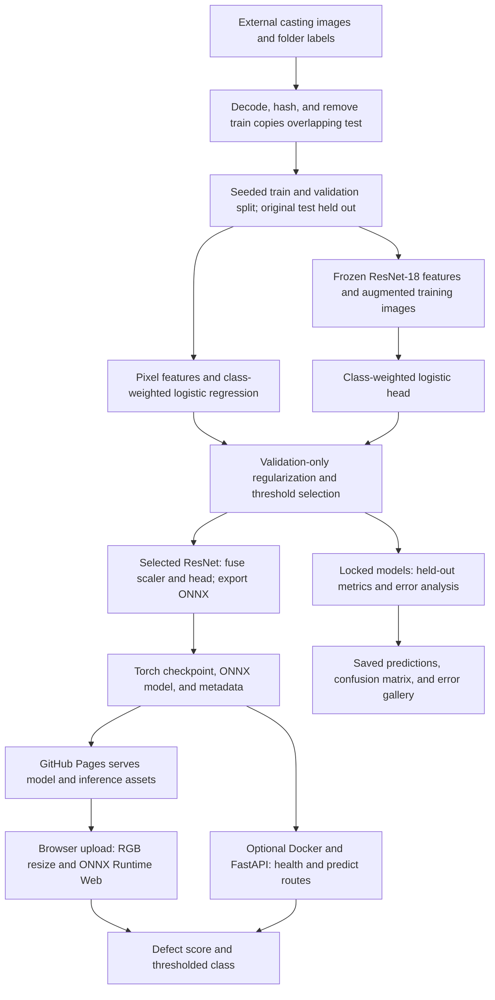
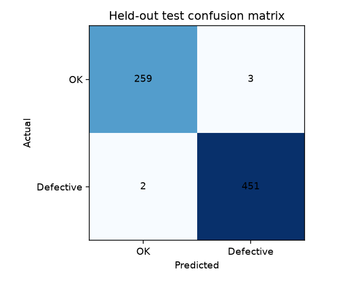

# Casting defect classification

A CPU-trained computer vision prototype for identifying defective front-view castings. It includes an independently trained baseline, a transfer-learning model, held-out evaluation, error analysis, a public inference interface, and a Dockerized REST API.

- **Live inference:** https://abdullah-sarwar-mirza.github.io/casting-defect-ml-assessment/
- **Repository:** https://github.com/Abdullah-Sarwar-MIrza/casting-defect-ml-assessment
- **Detailed decisions and errors:** [technical report](reports/technical_report.md)
- **Requirement-by-requirement evidence:** [assessment checklist](reports/assessment_checklist.md)

The live interface runs the exported trained model with ONNX Runtime Web in the browser. Select an image or try either held-out example. Image pixels stay on the device. The initial model download is approximately 43 MiB plus 11 MiB of runtime assets, then the browser can cache them. This is a public image-upload inference interface, as permitted by the assessment. The REST API below is supplied for local/container deployment; GitHub Pages hosts the browser interface.

## System architecture



The public inference path runs in the visitor's browser. The Docker REST API is a separate deployment option. Test data are used for final evaluation, never for selecting parameters; the baseline remains a separate saved artifact.

## Problem and dataset

Binary classification fits this dataset because labels are attached to complete images, with no bounding boxes or masks. A missed defect is the primary risk; false alarms increase manual review. The objective is a defensible prototype, rather than autonomous acceptance of manufactured parts.

Source: Ravirajsinh Dabhi, [casting product image data for quality inspection](https://www.kaggle.com/datasets/ravirajsinh45/real-life-industrial-dataset-of-casting-product). The images are 300 x 300 front views of cast parts. This is a practical industrial texture and shape problem, rather than a toy digit dataset. Images live in class folders: `ok_front` -> 0 (acceptable), `def_front` -> 1 (defective). The full dataset is excluded from Git. The two demo images and error-gallery derivatives are attributed to the same upstream dataset; upstream licensing and terms apply to those images.

| Supplied partition | Acceptable | Defective | Total |
|---|---:|---:|---:|
| Train | 2,875 | 3,758 | 6,633 |
| Test | 262 | 453 | 715 |
| Total | 3,137 | 4,211 | 7,348 |

The audit checks decoding, image dimensions, byte hashes, decoded-pixel hashes, conflicting duplicate labels, and cross-split exact overlap. It found **64 training images that were exact decoded-pixel copies of test images**, zero corrupt images, zero conflicting exact-duplicate labels, and no duplicates within the supplied test set. All 64 overlapping training copies are removed, preserving the complete test partition, before creating a seeded, stratified validation split. The alternate 512 x 512 dataset is deliberately excluded because it may contain related images.

| Final split | Acceptable | Defective | Total |
|---|---:|---:|---:|
| Train | 2,249 | 3,006 | 5,255 |
| Validation | 562 | 752 | 1,314 |
| Test (supplied, untouched) | 262 | 453 | 715 |

See [audit](reports/data_audit.json) and [complete split manifest](reports/manifest.csv). Exact decoded-pixel hashes are disjoint across all three splits. Physical-part and acquisition-session identifiers are unavailable, so transformed near duplicates and source-level dependence remain possible. Confidence intervals are conditional on this supplied split and do not establish production generalization. Folder labels are assumed, not certified by a manufacturing expert.

## Models, preprocessing, and tuning

1. **Baseline:** grayscale 32 x 32 pixel features, standard scaling, and class-weighted logistic regression. This is inexpensive and establishes how much can be learned from coarse appearance without a pretrained CNN.
2. **Stronger model:** ImageNet-pretrained ResNet-18, frozen as a 512-dimensional feature extractor, followed by standard scaling and a newly trained class-weighted logistic head. RGB inputs are resized to 128 x 128 with antialiased bilinear interpolation and ImageNet normalization. Normalization is embedded in the exported model. A fixed, frozen encoder reduces CPU training cost and overfitting risk on a small dataset; no full-network fine-tuning is claimed.

Training uses original images plus one seeded augmented image per training image: a horizontal or vertical flip and brightness factor in [0.9, 1.1]. The front-view parts have no known orientation-dependent class meaning. Validation and test images receive no random augmentation. Both classifiers use inverse-frequency class weights for moderate imbalance.

Four regularization strengths are compared per model. Baseline C: 0.001, 0.01, 0.1, 1; transfer C: 0.01, 0.1, 1, 10. For each fit, a fixed threshold grid is scored on validation defect F2, favoring recall; validation macro F1 selects regularization and model family. F2 tie-breaks and preference for smaller C are deterministic. Chosen baseline: C=1, threshold=0.25; chosen transfer model: C=0.1, threshold=0.50. Choices are written before test inference. No test result is used to retune a model, threshold, or augmentation.

See [all eight tuning trials](reports/tuning_trials.json) and [locked validation selections](reports/validation_selection.json). Feature caches include the full manifest, configuration, weights identifier, and augmentation recipe in their fingerprint. Delete `cache/` for a fresh extraction.

## Held-out results

| Model | Accuracy | Balanced accuracy | Macro F1 | Defect precision | Defect recall | ROC AUC |
|---|---:|---:|---:|---:|---:|---:|
| Pixel logistic baseline | 85.73% | 82.63% | 0.8391 | 84.89% | 94.26% | 0.9575 |
| Frozen ResNet-18 + trained head | **99.30%** | **99.21%** | **0.9925** | **99.34%** | **99.56%** | **0.9998** |

Selected-model confusion matrix (rows=true, columns=predicted; acceptable first): `[[259, 3], [2, 451]]`. This means **2 missed defects and 3 false alarms** out of 715 images. Defect average precision is 0.9999; Brier score is 0.00488. Scores have not been calibrated for deployment or distribution shift.

Stratified bootstrap, 1,000 resamples: 95% accuracy interval **98.60-99.86%**; defect recall **98.90-100%**; macro F1 **0.9849-0.9985**. These intervals assume independent examples within class; related acquisitions could make them too narrow.




The two missed defects have scores 0.120 and 0.409. One is confidently wrong, so merely reviewing uncertain scores would not catch every failure. False-positive images contain visible machining texture and/or illumination gradients, but five errors cannot establish a causal failure mode. Four errors occur in the middle contrast third and both misses in the middle brightness third, which does not support a simple extreme-lighting explanation. Review individual images in the [technical report](reports/technical_report.md), [error records](reports/misclassifications.json), and [quantitative slices](reports/error_slices.json).

First full pipeline run: **253.8 seconds on CPU**, four Torch threads, no GPU. This includes auditing, feature extraction, eight classifier fits, evaluation, bootstrap intervals, export, and plots. Pretrained weights were already cached; downloads and browser/runtime setup are excluded. See [machine-readable results](reports/results.json), [run log](reports/training.log), and [every test prediction](reports/test_predictions.csv).

## Reproduce

Use Python 3.12. Runtime, training, and development dependencies are separated; the public demo and REST API do not require Torch.

```bash
python -m venv .venv
# Windows PowerShell:
.\.venv\Scripts\Activate.ps1
# Linux/macOS: source .venv/bin/activate
python -m pip install -r requirements-train.txt
python -m casting_ml.train --config config.json --dataset-root /path/to/casting_data/casting_data
```

Expected data layout:

```text
casting_data/casting_data/
  train/ok_front/*.jpeg
  train/def_front/*.jpeg
  test/ok_front/*.jpeg
  test/def_front/*.jpeg
```

The local default `dataset_root` is `../casting_data/casting_data`, referring to the existing dataset outside this project. Change the config or pass `--dataset-root`; no images need to be copied into an existing project. Parameters for seed, batch size, image size, CPU threads, regularization, and threshold grid are in [config.json](config.json). Training uses Torch deterministic algorithms and NumPy/random seeds. Floating-point results may differ slightly across library/platform builds. Pretrained weights download automatically if absent.

The repository includes `artifacts/model.pt` (Torch checkpoint), `artifacts/baseline.npz` (NumPy baseline parameters, no pickle), `artifacts/metadata.json`, and `docs/model.onnx`. The deployment uses the same selected trained head, with its feature scaler fused algebraically. Checksum validation prevents loading mismatched artifacts. Torch/ONNX numerical parity was checked on 20 held-out images; maximum absolute probability error was 6.82e-7.

## REST API and Docker

```bash
python -m pip install -r requirements.txt
uvicorn casting_ml.api:app --host 0.0.0.0 --port 8000
curl http://localhost:8000/health
curl -X POST http://localhost:8000/predict -F "file=@docs/example-defective.png"
```

Interactive API documentation: `http://localhost:8000/docs`. `POST /predict` returns the class, defect score, decision threshold, model name, and latency. PNG and JPEG are supported; uploads are capped at 10 MiB and 20 megapixels. The service validates image content, handles corrupt uploads with 400, missing files with 422, and oversized bodies with 413. Model loading and warm-up happen once at startup; inference is offloaded from the event loop with bounded model concurrency. The prototype has no authentication or global rate limiting; place those at a gateway before exposing the API to untrusted traffic. `MODEL_PATH` and `METADATA_PATH` configure artifact locations.

```bash
docker build -t casting-defect-ml .
docker run --rm -p 8000:8000 casting-defect-ml
```

The container runs as a non-root user, has a health check, and contains only runtime code, metadata, and the ONNX model. It does not contain the dataset, Torch, training caches, Git credentials, or another assessment.

## Public deployment and checks

GitHub Pages serves `docs/` on the `main` branch. ONNX Runtime Web 1.22.0 is vendored with its MIT license, so inference has no third-party CDN dependency. The browser uses a single WebAssembly thread, requiring no cross-origin isolation headers. It reproduces antialiased bilinear resizing rather than relying on browser canvas downsampling. Browser decoding and fixed-point rounding can still produce small differences from Pillow; real-browser parity checks use a 0.02 absolute score tolerance and verify matching classes on the included examples.

```bash
python -m pip install -r requirements-dev.txt
python -m pytest -q
python -m scripts.browser_smoke
python -m scripts.browser_smoke --url https://abdullah-sarwar-mirza.github.io/casting-defect-ml-assessment/ --live
```

Browser verification uses an installed Microsoft Edge, falling back to Playwright Chromium. Run `python -m playwright install chromium` if neither is installed. It checks both held-out example buttons, a real file upload, rejection of an invalid image, browser errors, failed asset requests, and parity against Python ONNX inference. Evidence is saved under `reports/`. Public hosting must be rechecked at submission time; see the [deployment verification](reports/deployment.md). A brief [walkthrough](reports/walkthrough.md) covers the demo and evidence.

## Project layout

```text
casting_ml/       data preparation, model, training, evaluation, inference, API
config.json      experiment parameters
artifacts/       Torch model, baseline parameters, model metadata
reports/         audit, split manifest, tuning, metrics, predictions, errors, verification
scripts/         browser verification, vendor assets, independent publishing helper
tests/          inference, validation methodology, and API checks
docs/           public inference interface, ONNX model, vendored runtime, demo samples
Dockerfile       runtime-only REST service
.github/         automated tests
```

This project has its own Git repository and history. It uses the external dataset read-only and does not import code or artifacts from the pre-existing assessment.

## Limits and next experiments

The public dataset covers one part/view and restricted acquisition conditions, with no defect-subtype annotations. High benchmark accuracy does not demonstrate robustness to new factories, cameras, materials, or unseen defects. Two-dimensional class labels cannot locate a defect. Scores are not a rejection guarantee.

With additional compute and data: collect part/session IDs and a new source-held-out evaluation set; review the five errors with an expert; add hard-negative and subtle-defect annotations; compare higher-resolution (224/300) inputs and fine-tuning the final ResNet block; test augmentations by validation ablation; calibrate probabilities on independent validation data; evaluate illumination/camera shifts; and optimize defect recall subject to an operational false-alarm budget. Detection or segmentation would require newly annotated defect locations. None of these test-derived hypotheses has been used to alter the reported model.

## Final verification

Reviewed on **17 October 2026** using the existing trained artifacts. No model weights, thresholds, configuration, original test predictions, or original evaluation results were changed.

| Check | Verified result | Evidence |
|---|---|---|
| Automated tests | **16 passed, 0 failed, 0 skipped** locally, including API validation, split integrity, metrics for both models, and baseline replay on all test images. | [Verification summary](reports/verification.json), `python -m pytest -q` |
| Public deployment | The [live inference interface](https://abdullah-sarwar-mirza.github.io/casting-defect-ml-assessment/) loaded and ran the actual model. Its hosted ONNX SHA-256 matches the local model. | [Live browser record](reports/live_browser_verification.json), [deployment details](reports/deployment.md) |
| Image uploads | Normal and defective images passed both example buttons and the actual file-upload control. Defect scores were **0.031512** and **0.997818**, respectively, at threshold **0.50**. Invalid image data were rejected; there were no page errors, failed requests, or HTTP error responses. | [Browser evidence and upload scores](reports/live_browser_verification.json), [screenshot](reports/live_browser.png) |
| Model artifacts | Torch checkpoint, baseline NumPy parameters, and ONNX model match their committed SHA-256 hashes. Torch/ONNX metadata checksums and both metadata copies agree. All three artifacts were replayed over **715 test images** and reproduce the original confusion matrices. | [Artifact hashes and replay](reports/evaluation_verification.json) |
| Reported metrics | Recomputed both models' metrics from the saved predictions, matching the original results within absolute tolerance **1e-8**. Reproduced both seeded 1,000-resample bootstrap intervals. Selected-model accuracy remains **99.30%**, with **2 missed defects and 3 false alarms**; baseline accuracy remains **85.73%**. | [Replay evidence](reports/evaluation_verification.json), [original results](reports/results.json), [original predictions](reports/test_predictions.csv) |
| Reproducibility | All **7,348** input byte and decoded-pixel hashes match the split manifest. Read-only replay uses the existing artifacts and fixed config; `pip check` found no broken requirements. Training and a fresh-environment installation were **not rerun** in this review. | [Replay script](scripts/verify_evaluation.py), [config](config.json), [manifest](reports/manifest.csv) |

Score replay is numerical rather than bit-identical: the largest baseline difference from saved probabilities was **1.61e-6** (tolerance 1e-5); ONNX versus saved probabilities was **7.57e-6**, and Torch versus ONNX was **7.99e-6** (tolerance 1e-4). Classification counts remain unchanged. These measured rounding differences do not replace the original evaluation results. Browser versus Python differences on the two examples were at most **1.72e-5**.

To repeat the checks, run these commands from the root of a **Git clone** after installing `requirements-dev.txt` and making the external dataset available:

```bash
python -m pip check
python -m pytest -q
python -m scripts.verify_evaluation --dataset-root /path/to/casting_data/casting_data
python -m scripts.browser_smoke
python -m scripts.browser_smoke --url https://abdullah-sarwar-mirza.github.io/casting-defect-ml-assessment/ --live
```

The Git clone is required for the artifact comparison against committed files. Without the external dataset, the saved-baseline replay test skips; the full evaluation replay requires it. The remaining tests use repository artifacts. The test run emitted one upstream Starlette TestClient deprecation warning. The Docker evidence is from **16 October 2026** and was not rerun in this review; see [container verification](reports/container_verification.json). The public deployment should be rechecked at submission time.
