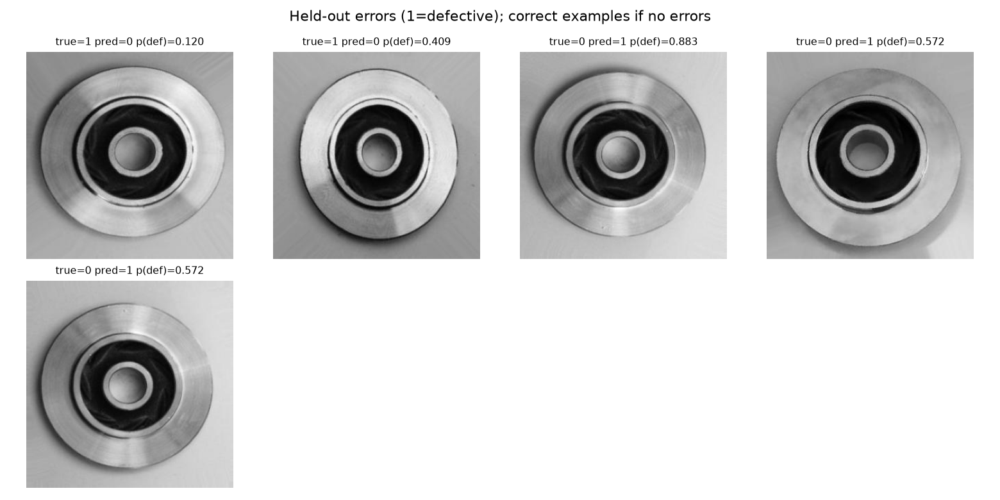

# Casting Defect Classification

Technical report | 17 October 2026

[PDF edition](technical_report.pdf)

## 1. Problem definition

Image-level binary labels support classification. The dataset contains real industrial imagery and subtle boundary/texture differences. A detection or segmentation model would require additional annotations. The trained classifier answers whether a front-view casting resembles the supplied defective class; it cannot explain the physical defect or authorize shipment.

## 2. Dataset and preparation

All 7,348 files decode as 300 x 300 images. There are 64 exact decoded-pixel duplicate groups spanning the supplied train and test folders. All 64 overlapping training copies are excluded before stratified train/validation splitting; all original test images are retained. No corrupt file, conflicting exact duplicate label, or test duplicate was found. The final partitions are 5,255 training, 1,314 validation, and 715 original test images. Decode hashes are disjoint across partitions. No additional data from casting_512x512 are mixed in.

Some image collections include augmented versions of the same physical sample. Exact hashes do not detect those. Part/session IDs are unavailable; this is an explicit limitation rather than a claim of source-independent generalization. Imbalance is moderate (approximately 57% defective in training); inverse-frequency class weights and macro/recall metrics address it without discarding acceptable parts.

## 3. Models and training

The baseline trains a scaled linear decision boundary over 1,024 grayscale pixels. It cannot readily model local defect textures or invariance to orientation, but is fast and informative. Its test accuracy is 85.73%, with 26 false negatives and 76 false positives at its validation-tuned threshold.

The stronger model uses a frozen pretrained convolutional encoder and trains only its logistic head. Generic edge, shape, and texture representations transfer to cast-part imagery, although the domain differs from ImageNet. Feature extraction runs once, then four regularization candidates are inexpensive. Resizing to 128 pixels is a deliberate CPU/memory tradeoff; it can erase fine damage. One flipped/brightness-adjusted view per training image supplies limited invariance. Fine-tuning the encoder was unnecessary for this prototype and has not been performed. Using pretrained weights is justified by sample size and compute constraints, rather than by a promise of universal domain transfer.

Four C values per model and a fixed threshold grid are evaluated only on validation. F2 prioritizes defect recall when choosing thresholds; macro F1 chooses C and model family. C=0.1 and threshold=0.50 won for ResNet. The untouched test set is then evaluated once, with no model changes after viewing errors. Full model selection records precede test inference in the implementation.

## 4. Evaluation results

The selected model correctly predicts 710/715 images: 259/262 acceptable parts and 451/453 defective parts. Accuracy is 99.30%, balanced accuracy 99.21%, macro F1 0.9925, defect precision 99.34%, defect recall 99.56%, ROC AUC 0.9998. The 95% stratified-bootstrap accuracy interval is 98.60-99.86%; defect recall is 98.90-100%. The bootstrap assumes independent examples, an assumption the missing source IDs prevent verifying. A high AUC does not eliminate the two actual missed defects.

## 5. Error analysis

Image observations below are hypotheses from visual inspection, not expert defect diagnosis. Labels were not changed and no threshold was retuned.

| File | True / predicted | Defect score | Observations and improvement hypothesis |
|---|---|---:|---|
| `cast_def_0_2154.jpeg` | defective / acceptable | 0.120 | The overall disc is regular; a local irregularity is visible around the inner bright rim on the right. The globally pooled 128-pixel representation may lose a small local cue. Higher resolution and localized annotations could preserve the small visual cue. This confidently wrong example would escape an uncertainty-only review queue. |
| `cast_def_0_1607.jpeg` | defective / acceptable | 0.409 | The outer contour and upper-right rim have small irregularities; strong surface illumination may reduce the prominence of local features. Expert assessment of the original and higher-resolution crops could clarify the local cue. |
| `cast_ok_0_259.jpeg` | acceptable / defective | 0.883 | Visible surface texture and a pronounced diagonal illumination band could resemble defect cues. Expert-confirmed hard negatives and lighting-robust features are potential improvements. The high score cannot establish which visual feature caused the decision. |
| `cast_ok_0_1137.jpeg` | acceptable / defective | 0.572 | Broad uneven shading and fine surface marks appear on a part with the acceptable folder label. This is close to the threshold; expert review could distinguish acceptable finish from genuine damage. |
| `cast_ok_0_7839.jpeg` | acceptable / defective | 0.572 | Fine machining texture and a different pose/illumination pattern may contribute to a borderline positive prediction. Orientation and illumination ablations on new validation examples could test this hypothesis. |

The middle contrast third has 4/238 errors (1.68%); the low contrast third has 1/238 (0.42%); the high contrast third has 0/239. The middle brightness third has 3/238 errors, including both misses; the high brightness third has 2/239; the low third has none. Five errors are insufficient to establish a stable failure pattern, and the slice boundaries were descriptive post-hoc analysis. Production improvements require new data and validation; the test images should not become a tuning set.

## 6. Inference and verification

The scaler and learned logistic head are folded into a single Torch layer and exported with the encoder to ONNX. This eliminates pickle and training-library dependencies in the service. Saved Torch and ONNX artifacts were replayed over all 715 test images; maximum absolute score difference was 7.99e-6. SHA-256 metadata verifies model identity on API startup. Input handling is shared conceptually: EXIF-aware RGB conversion, antialiased bilinear 128 x 128 resize, CHW float [0,1], normalization inside the graph. The browser implements the bilinear filter explicitly and is checked against Python. JPEG decoders and fixed-point rounding may introduce minor differences; the browser smoke test records them.

A public upload interface runs the real ONNX model in WebAssembly on GitHub Pages; inference executes locally on the uploaded image. The interface also offers the saved pixel logistic baseline. The model selector reruns the current image with the selected model, using its own preprocessing and decision threshold (0.25 for the baseline, 0.50 for ResNet). The REST API exposes the same model choices through its model query parameter. Vendored runtime/model assets remove CDN availability from inference. Startup download cost and browser CPU/memory requirements are its main limitations. The optional REST deployment uses FastAPI/ONNX Runtime, request validation, 10 MiB/20 megapixel limits, startup warm-up, checksum verification, bounded CPU threads, and serialized model calls. A non-root Docker image keeps runtime separate from training. Global authentication/rate limiting is outside the prototype scope.

## 7. Limitations and further experiments

Further experiments would use new capture sessions, expert labels, and a source-held-out evaluation set. Higher resolution and final-block fine-tuning could be compared using defect recall and false-alarm rate. Additional annotations would support defect-category analysis, hard-negative sampling, calibration, and drift evaluation. Feature caching allows inexpensive head sweeps; additional compute should initially fund better evaluation and data, rather than only a larger network. Detection/segmentation requires defect-location supervision absent here.

## References

- Dataset: Ravirajsinh Dabhi, [casting product image data for quality inspection](https://www.kaggle.com/datasets/ravirajsinh45/real-life-industrial-dataset-of-casting-product).
- [Evaluation results](results.json), [test predictions](test_predictions.csv), and [validation trials](tuning_trials.json).
- [Artifact replay](evaluation_verification.json) and [public inference verification](live_browser_verification.json).
